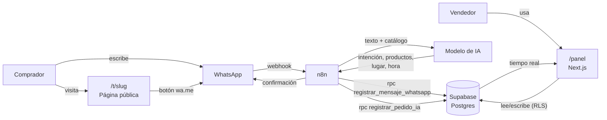
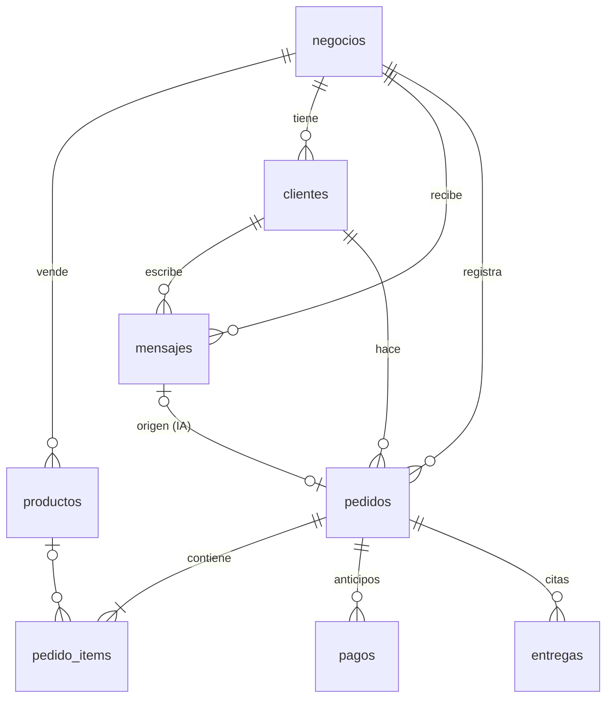

# Arquitectura



## Piezas

| Pieza | Responsabilidad | Por qué esta opción |
|---|---|---|
| **Next.js (web/)** | Panel del vendedor y página pública. Server Components leen de Supabase; Server Actions escriben. | Un solo proyecto para frontend y backend; despliegue gratis en Vercel. |
| **Supabase** | Postgres, login (correo + contraseña), tiempo real y, después, Storage para fotos y comprobantes. | Plan gratis, RLS para que cada vendedor vea solo lo suyo, n8n tiene nodo nativo. |
| **n8n** | Recibe webhooks de WhatsApp, llama a la IA y a las funciones de Postgres, responde al cliente. | Lo pide el proyecto; flujos visuales que todo el equipo entiende. |
| **IA** | Clasifica el mensaje y extrae el pedido en JSON. | Va dentro de n8n, así se puede cambiar de proveedor sin tocar código. |

## Decisiones importantes

1. **La lógica de datos vive en Postgres, no en n8n.** n8n llama funciones (`registrar_mensaje_whatsapp`,
   `registrar_pedido_ia`, …) en vez de hacer 5 inserts sueltos. Así se versiona en git, se puede
   probar con SQL y n8n queda simple.
2. **Seguridad con RLS.** El navegador usa la *publishable key*; Postgres filtra por `owner_id`.
   n8n usa la *secret key* (se salta RLS) y solo puede llamar las funciones.
3. **Un negocio por usuario** por ahora. La tabla ya tiene `owner_id`, así que pasar a varios
   integrantes por negocio es agregar una tabla `miembros` después.
4. **Pagos: solo se registran**, no se cobran en la página (pregunta abierta del análisis).
   Los anticipos se marcan como `verificado` cuando el vendedor confirma la transferencia.
5. **Cache Components de Next.js 16 está activo.** Todo lo que lee sesión o base de datos va
   dentro de `<Suspense>`. Ver el patrón en cualquier página de `web/src/app/panel/`.

## Modelo de datos



Detalle de columnas: [`../supabase/migrations/20261030000000_esquema_inicial.sql`](../supabase/migrations/20261030000000_esquema_inicial.sql).
La vista `pedidos_resumen` calcula `pagado` y `saldo` de cada pedido.

## Estructura de `web/src`

```
app/
  page.tsx              Landing
  login/                Iniciar sesión / crear cuenta (Server Actions)
  panel/
    layout.tsx          Menú + "crea tu negocio" si aún no tiene
    actions.ts          Todas las escrituras del panel
    mensajes/ pedidos/ anticipos/ entregas/ productos/
  t/[slug]/             Página pública de cada tienda
components/
  escuchar-cambios.tsx  Refresca la página con Supabase Realtime
lib/
  supabase/             Clientes de Supabase (navegador, servidor, proxy)
  negocio.ts            Quién es el usuario y cuál es su negocio
  types.ts              Tipos de las tablas
proxy.ts                Refresca la sesión y protege /panel
```
